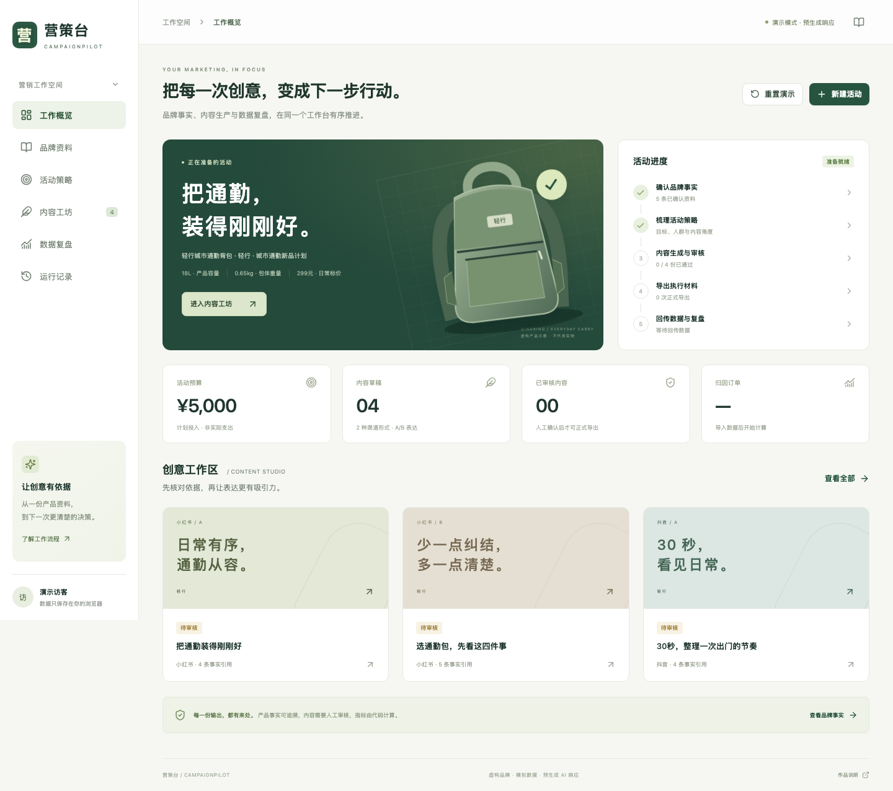
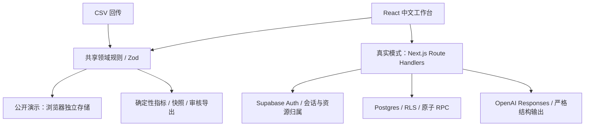

# 营策台 CampaignPilot

**把产品事实、营销内容和数据复盘串成一条可审核的工作流。**

一个面向 AI 营销解决方案岗位的个人作品：从品牌资料与活动需求出发，组织小红书文案、抖音文本脚本、人工审核、交付导出及 CSV 数据复盘。

[在线演示](https://campaignpilot-yingce-20261028.elated-rose-5505.chatgpt.site) · [验收报告](docs/06_VERIFICATION_REPORT.md) · [真实模式配置](docs/08_RUNBOOK.md) · [面试提交材料](docs/07_GITHUB_SUBMISSION.md)

> 公开演示使用虚构品牌“轻行”、模拟投放数据与预生成 AI 响应。编辑、审核、版本锁定、文件导出、CSV 校验和指标计算实际运行。公开演示不调用收费模型。
>
> 真实模式的服务端、数据库迁移和模型适配器已经实现；本次没有 Supabase 项目凭据与 OpenAI API Key，因此未完成真实云端登录及付费模型联调，不宣称真实 AI 质量评测通过。



## 5 分钟启动

使用 Node.js 24（`.nvmrc`），从源码目录运行：

```bash
npm ci
npm run dev:demo
```

打开 `http://127.0.0.1:5173`。不需要 `.env`、数据库或 API Key。

静态生产预览：

```bash
npm run build:demo
npm run preview:demo
```

打开 `http://127.0.0.1:5174`。完整 Next.js 应用使用 `npm run dev`，演示入口 `/`，真实模式入口 `/workspace`。

## 一条可实际走通的流程

1. 在“品牌资料”查看 5 条已确认事实及原文。来源代表用户提供的依据，不代表系统核实了现实真伪。
2. 在“活动策略”查看预算、三个内容角度、假设与信息缺口。
3. 在“内容工坊”打开小红书 A/B，核对文案与引用，分别点击“确认审核通过”。
4. 点击“导出已通过内容”，下载 Markdown 或 CSV；首次导出会锁定交付版本。
5. 在“数据复盘”点击“预览模拟数据”→“确认导入”，查看 CTR、CVR、CPA、ROAS。
6. 点击“查看样例复盘”，区分观察与假设；采用建议时先确认，再创建独立的下一轮活动。

修改品牌或需求后，已有内容会过期，固定样例不会冒充针对新输入的真实生成。点击“重置演示”可恢复初始案例。

## 已实现的能力

| 模块 | 实际行为 |
| --- | --- |
| 品牌事实 | 人工录入、确认、禁用表述、稳定事实 ID、历史来源快照 |
| 活动与策略 | 多活动、本地持久化、需求版本、预算与日期校验、三个内容角度 |
| 两渠道内容 | 小红书 A/B、抖音 A/B 文本脚本、分镜编辑、引用查看 |
| 人工审核 | draft/approved/rejected；改稿产生新版本；过期资料与阻断项不能批准 |
| 交付导出 | Markdown/CSV；锁定交付版本；后续改稿复制为新变体；CSV 公式防护 |
| 数据导入 | 2 MB/5,000 行；预览；行列错误；警告确认；整批校验；文件 hash 与自然键去重 |
| 确定性指标 | 金额以分存储；加总后计算比率；零分母 N/A；渠道与日期筛选 |
| 复盘与实验 | 不可变指标快照；过期提示；独立下一轮 brief；不自动发布或投放 |
| 真实模式代码 | HttpOnly 会话；服务端归属检查；RLS；事务、幂等、费用预留；结构化模型输出 |
| 可复现交付 | 锁文件、迁移、离线测试、浏览器测试、CI 定义、评测输入、录屏与样例 |

## 架构



- React + TypeScript；Next.js 提供真实服务端；Vite 构建同一 UI 的独立静态 demo。
- 领域规则集中在 `src/domain`，浏览器演示与服务端共享校验，服务端不会信任前端按钮状态。
- Postgres 使用活动聚合 JSONB 与不可变历史快照，另设执行账本及每日配额表。取舍和规模边界见 [实现决策](docs/05_IMPLEMENTATION_NOTES.md)。
- 模型只生成结构化建议。权限、预算、审核状态、导出、金额与指标由代码决定。

## 验证

```bash
npm run check
npx playwright install chromium
npm run test:e2e
npm run samples
npm run eval:prepare
```

离线测试覆盖领域逻辑、模型适配器故障、API 边界及 PGlite 中的 Postgres 迁移/RLS/事务。PGlite 测试不等于真实 Supabase 云端验收。

`npm run eval:run` 是显式启用的真实模型评测入口，默认不运行，需要另配环境变量。20 个常规场景（12 开发 / 8 保留，每个两轮）与 10 个异常场景已准备；评分字段保持 `null`。见 [评测说明](evals/README.md)。

## 黄金样例

| 合计 | 数值 |
| --- | ---: |
| 曝光 / 点击 / 归因订单 | 30,000 / 700 / 20 |
| 花费 / 销售额 | ¥1,400 / ¥5,380 |
| CTR / CVR | 2.3333…% / 2.8571…% |
| CPC / CPA | ¥2 / ¥70 |
| ROAS | 3.842857… |

只支持 CNY 与 `last_click_7d`。日期为点击发生日，订单与收入回填到点击日。ROAS 不等于净利润率，普通归因订单不等于首购，聚合 CSV 也不能证明上游归因真实可靠。

## 目录与资料

```text
app/                      Next.js 页面与 API 路由
src/domain/               类型、业务规则、指标、固定样例
src/ai/                   提示版本与模型适配器
src/server/               鉴权、归属检查、事务调用
src/ui/                   共用 React 界面与样式
supabase/migrations/      可从空库应用的 SQL
sites/campaignpilot-demo/ 静态演示入口
scripts/                  样本、评测、录屏与交付工具
 tests/                   单元、集成、浏览器测试
 evals/                   固定输入集；没有伪造的真实评分
artifacts/                截图、样本、验证记录、视频
 docs/                    规划、实现取舍、验收、面试与运维说明
```

原始规划保留在 `docs/00_PLANNING_INDEX.md` 与 `docs/01`–`04`，属于设计基线。实际状态以 [任务执行台账](docs/09_TASK_STATUS.md) 和 [验收报告](docs/06_VERIFICATION_REPORT.md) 为准。

## 边界

公开版本为面试演示，不是完整商业营销平台。不含自动发布、广告账户连接、真实投放、图片/视频生成、多组织协作、增量数据纠错或后台队列。没有真实销售提升或效率实验数据，因此不提供此类效果承诺。

真实模式每个步骤最多两次尝试、单次 20 秒、总预算 45 秒；超时/断连结果记为 unknown，保留预算，不宣称未计费。价格配置用于应用估算，供应商账单才是最终依据。

源码采用 [MIT License](LICENSE)。品牌、内容与数据为本项目虚构样例。实现过程中使用了 AI 辅助，面试中的个人贡献应按实际参与说明。
